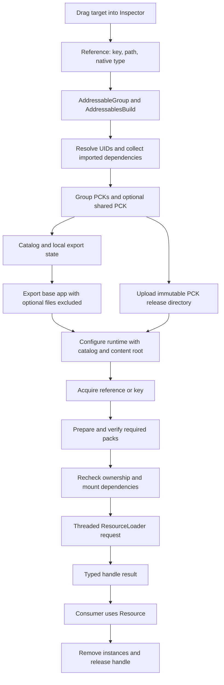

# Architecture and lifecycle

Version 0.1.0 is experimental. This document describes the implemented pipeline;
it does not promise Unity API compatibility. See [API](API.md) for contracts and
[Usage](USAGE.md) for complete application examples.

## Components and boundaries

| Layer | Owns | Does not own |
| --- | --- | --- |
| Inspector | Lightweight reference authoring and target selection | Runtime loading |
| Builder | Dependency collection, PCKs, catalog and export state | Application code compilation or uploading |
| Export filter | Optional-content exclusion and catalog injection | Deleting source files |
| Addressables Node | Catalog snapshot and shared resource operations | Gameplay, instantiated nodes or disk eviction |
| Handle | One acquisition of an operation | Other consumers' acquisitions |
| Scope | A collection of handles | Scene instances, pools or audio players |
| Pack store | Transfers, integrity checks, cache and mounting | Resource ownership |
| C# facade | A service Node and typed handle wrappers | Global application lifetime |

The addon does not install an autoload. An application creates a service under a
Node that lives longer than all its consumers. Each service owns its own resource
registry. Mounted-pack records are static and shared within the process.

## Full flow

### Authoring

`AddressableReference` contains string metadata rather than a direct target
Resource. Inspector assignment constructs a new reference, using a UID key when
available and a path key otherwise. Keeping the scene containing this metadata
loaded does not itself load the target scene or texture.

UID resolution belongs to authoring/building. At runtime, a key is looked up in
the configured catalog. There is no fallback that loads `source_path` when a key
is missing. Development source mode also requires a catalog entry.

A semantic key such as `prefabs/crate` is allowed, but the application and build
group must share that key. Dragging the target into another field creates fresh
metadata with its default UID/path key. The plugin does not synthesize aliases.

### Building

The builder validates groups, resolves source UIDs, checks native Resource types,
and traverses dependencies. Existing UID mappings take priority over stale
fallback paths embedded in scenes, including after a dependency rename.

Source files, `.import` remaps and imported payloads are collected. Executable
scripts/extensions stay in the base application and are listed as base
dependencies. A top-level script cannot be an addressable content target. A
remote scene can depend on shipped code; a content pack cannot introduce newly
compiled application code through this pipeline.

Files used by multiple groups go into `__shared`. Other files go into their group
pack. Group packs depend on `__shared` when needed. Catalog entries for targets
shared across groups point directly to the shared pack. Dependencies are built
without temporary scene instances.

Each PCK is hashed after writing and receives a hash-bearing filename. The
catalog records its size, SHA-256, dependencies and declared file list. Metadata
uses temporary files and rename; the complete multi-file build is not one atomic
transaction. Publish only a successful build as a complete immutable release.

### Exporting

Build state in `.godot/addressables/export.json` connects the builder to the
export plugin. It records source/config hashes and the catalog hash. When state
is available, the filter excludes collected optional files, build resources,
editor/test scripts and the content output directory. It injects the catalog at
`res://addressables/catalog.json`.

Without build state, the filter does not infer optional targets. A normal Godot
export can then retain assets that should have been external. Rebuild after
cleaning `.godot` and before exporting.

Changed source/config/catalog data produces export errors. Godot can nevertheless
return exit code zero after reporting an export error. The checked Python export
wrapper rejects nonzero exits and `ERROR:` output. It neither deletes an old
artifact nor uploads anything. The publishing pipeline must gate on its result.

## Runtime acquisition

`load_asset()` returns a separate token immediately. The catalog resolves its key
to a resource path. Operations are shared by that path within one service, so
aliases and simultaneous consumers can share a request while retaining separate
ownership counts and expected types.

The deferred start follows this order:

1. Check whether the service closed or all owners released.
2. Unless source mode is enabled, prepare the pack dependency closure.
3. Check ownership again before mounting; a canceled consumer need not mount.
4. Mount dependencies first with replacement disabled.
5. Recheck closure/ownership, validate resource existence and start the threaded request.
6. Poll the engine each frame and collect the result, including failed requests.
7. Expose a successful Resource through handles whose expected native type matches.

`configure()` sets `PROCESS_MODE_ALWAYS` so engine polling and child HTTP requests
continue while the tree is paused. Do not override that mode or remove the owner
before asynchronous cleanup completes. Application continuations and custom
timeouts must also have a live scene tree.

## Ownership, cancellation and retry

Every `load_asset()` call adds one owner. Releasing token A leaves token B valid.
A type mismatch fails only that token; another token with the correct expected
type can use the same underlying result.

When the final owner releases, the registry drops its strong result reference.
An already-started engine request cannot be canceled through Godot's resource
loader API. It remains registered until collected; a later acquisition can join
that work. Pre-download work can finish and populate disk cache even when its
original consumer has gone away. The ownership check prevents an abandoned
operation from proceeding to a new mount/load.

Failed operations are removed from the registry, allowing a later acquisition
to retry. Old tokens still expose their own failed operation. Identity checks
ensure late cleanup of an old operation does not erase its replacement.

Handles provide pre-delete ownership cleanup as a fallback. Explicit `release()`
or C# `Dispose()` remains the predictable path. Do not depend on finalizer/GC
timing, especially with .NET wrappers or retained references.

Scopes retain handles and release them together. `load_all()` starts a batch,
waits in order and rolls back that batch on failure. It is not fail-fast. Prior
successful batches remain owned. Repeated keys create repeated tokens; deduplicate
application inputs when one token per key is desired.

## Three different lifetimes

| State | Created by | Released by |
| --- | --- | --- |
| Resource ownership | Handle acquisition | Explicit release/disposal; pre-delete fallback |
| Mounted PCK | First successful pack mount | Process termination; no unmount API here |
| Cached PCK bytes | Verified download/local copy | External cache policy; no eviction API here |

`owners == 0` does not prove that native RAM/VRAM is free. Instantiated scenes,
textures on controls, audio streams, pools, static fields, closures and C# object
wrappers can retain resources. Clear those references before releasing the token.
Do not manually dispose a shared Resource as a substitute for releasing ownership.

## Transfer and mount rules

The store deduplicates simultaneous transfers by SHA within that store, not
globally across all services. Cache filenames are content hashes. Temporary
filenames include a store identifier to avoid sharing an incomplete file.
Local content roots follow the same copy/verify/cache path without HTTP.

Remote transfers require direct HTTPS URLs, HTTP 200 and bounded declared size.
Redirects are disabled. Loopback HTTP is opt-in for testing. Partial downloads
are size/hash checked before committing the final cache filename. Invalid cached
files are fetched again. There is no range resume or automatic retry/backoff.

The default 30-second timeout measures time without downloaded-byte progress,
including an unresponsive connection. A slow transfer that keeps progressing can
take longer. An overall user-facing deadline belongs to the application.
Hashing and local copying are synchronous; profile representative pack sizes.

Mounting rejects existing declared resource paths and uses
`load_resource_pack(..., false)`. Successful mounts are recorded process-wide by
SHA. There is no hot replacement or catalog update transaction. Start a fresh
process to switch incompatible content at the same resource paths.

## Shutdown order

1. Prevent new consumer work and late completion callbacks from spawning instances.
2. Remove instances, stop audio and clear application-held Resource references.
3. Release handles/scopes.
4. Await `shutdown()` or `ShutdownAsync()` while the owner remains in the tree.
5. Remove the owning Node. GDScript `shutdown()` does not free it; the C# facade does.

`close()` invalidates results and cancels HTTP without waiting. The GDScript
`_exit_tree()` fallback synchronously collects remaining resource requests and
can block. Async cleanup started only after leaving the tree cannot be relied on.

## Trust and compatibility

Trust the catalog and the pack publisher. SHA-256 checks byte identity against
that catalog; it does not authenticate a hostile catalog or sandbox mounted
content. This addon does not manage catalog signatures, access control or user
entitlements.

Generated catalogs identify the Godot major/minor and target platform. Runtime
rejects mismatches. Correct platform metadata alone does not guarantee correct
import artifacts: build/export with the intended engine, import profile and
platform SDK, then validate on the real device.
